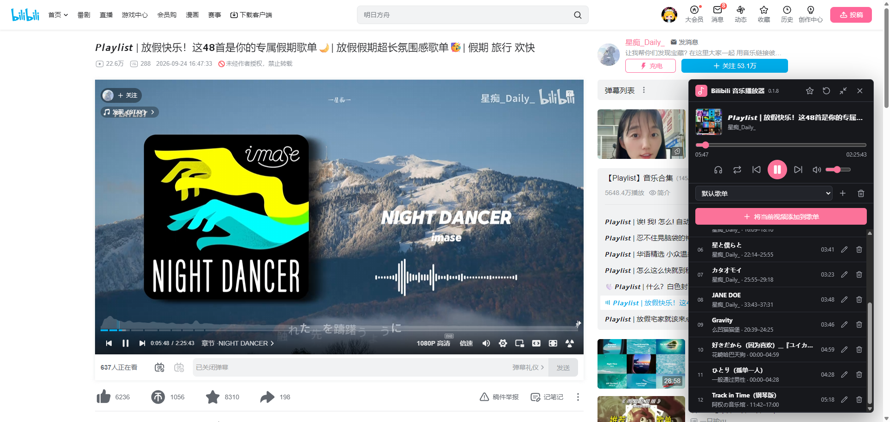

  <h1>Bilibili Music Player B站音乐播放器</h1>

  
为了方便使用B站网页端听音乐，在B站视频页面添加了悬浮音乐播放器。

  

## 主要功能

- 创建和管理多个歌单
- 将当前视频或视频切片添加为歌曲，支持自定义时长和歌名，支持识别视频章节并一键添加
- 支持从收藏夹，合集以及视频选集批量导入歌曲
- 歌曲行常驻复选框：多选后可全选／取消并批量删除当前歌单里的歌曲（删除前有确认弹窗）
- 歌曲支持长按拖动排序，也可用方向键排序；拖到列表上下边缘会自动滚动
- 设置面板：选择悬浮按钮的打开方式（记住上次／完整模式／极简模式）、重置悬浮窗位置、查看版本与备份格式
- 支持把全部歌单导出为本地 JSON 备份，并从备份文件全量恢复歌单
- 纯音频模式，仅保留原生音频播放
- 极简模式，单行播放器显示歌曲信息和播放控制
- 多个标签页可独立播放插件歌单；歌单内容和音量保持同步

## 文档

- `docs/AI-CONTEXT.md`：面向 AI 代理的项目自然语言说明书（是什么、模块地图、数据模型、关键机制、硬约束、改动检查清单）。
- `docs/architecture.md`：架构设计与运行流程。
- `docs/testing.md`：单元测试、浏览器测试和发布前手工检查。

## 注意事项

- 本脚本挂靠于篡改猴 Tampermonkey，需提前下载并在浏览器中开启“允许运行用户脚本”的权限。
- 跨 BV 切歌需要页面跳转，受加载速度影响，可能存在短暂停顿。
- 刷新或跨 BV 切歌会保留当前标签页的播放会话；关闭标签页后，该标签页的当前歌曲与进度会自然清除。
- 歌单可以导出为本地 JSON 文件（标题栏齿轮 → 设置 → 数据管理 → 导出备份）。**导入是全量覆盖**：会用文件里的歌单替换当前全部歌单，未包含在文件里的歌单会被删除，且不会自动备份、无法撤销——导入前请先导出一份当前歌单。导出/导入都只处理歌单库，不含音量、播放进度、纯音频开关和界面位置，也不会把任何数据上传到云端。
- 本脚本不收集或上传个人数据，不下载B站音视频流，只控制页面中已有的播放器。
